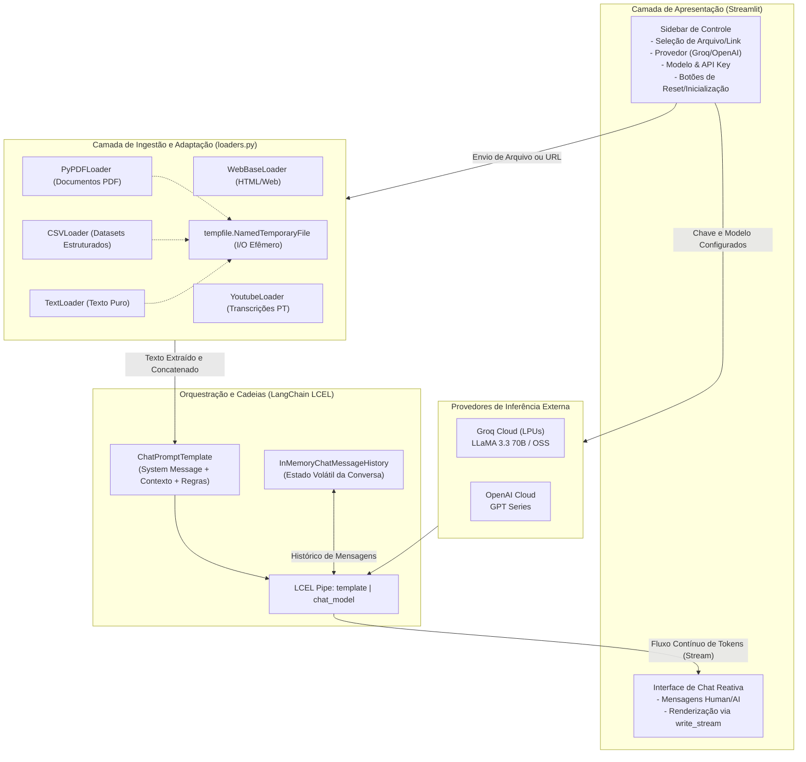

# Documento Descritivo de Projeto — Oráculo

> **Identificador do Projeto:** Oráculo — Assistente Conversacional Multimodal com Grounding Documental  
> **Status:** 🟡 Em Andamento (*Work in Progress* / Projeto de Portfólio)  
> **Área / Domínio:** Inteligência Artificial Generativa, Engenharia de LLMs, RAG (*Retrieval-Augmented Generation*), Desenvolvimento Web Full-Stack (Python)  
> **Data de Atualização:** Outubro de 2026  

---

## 1. Visão Geral e Resumo Executivo

O **Oráculo** é uma plataforma conversacional inteligente voltada para a extração de conhecimento, análise e interação em linguagem natural sobre documentos e mídias heterogêneas. O sistema permite que o usuário carregue diferentes fontes de dados — arquivos locais (**PDF, CSV, TXT**) e links remotos (**páginas web e transcrições de vídeos do YouTube**) — e estabeleça um diálogo contextualizado com modelos de linguagem de ponta (*Grounding Documental*).

Um dos principais diferenciais arquiteturais do Oráculo é a **eliminação do aprisionamento tecnológico (*vendor lock-in*)**: o sistema adota uma infraestrutura desacoplada com suporte dinâmico a múltiplos provedores de IA (*Multi-LLM*):
- **Groq Cloud API:** Utilização de hardware especializado em LPUs (*Language Processing Units*), permitindo geração ultraveloz (300+ tokens/segundo) com modelos abertos como **LLaMA 3.3 70B Versatile**.
- **OpenAI API:** Integração com os modelos de referência da família **GPT** para tarefas analíticas que demandam raciocínio lógico avançado.

A aplicação opera sob o modelo **BYOK (*Bring Your Own Key*)**, garantindo privacidade, descentralização de custos e segurança das credenciais, as quais são mantidas estritamente voláteis durante a sessão do usuário.

---

## 2. Objetivos do Projeto

### 2.1. Objetivo Geral
Conceber e implementar uma solução unificada, modular e de alta responsividade para consulta e análise contextual de documentos heterogêneos, utilizando as melhores práticas contemporâneas de engenharia de software e orquestração de LLMs (LangChain, Streamlit e streaming de tokens).

### 2.2. Objetivos Específicos
1. **Ingestão Multi-Formato Unificada:** Criar uma camada extensível de carregadores (*loaders*) capaz de extrair e unificar conteúdos textuais de PDFs, CSVs, TXTs, URLs da web e transcrições do YouTube.
2. **Alternância Dinâmica de Provedores:** Permitir a troca instantânea entre provedores e modelos de IA na interface gráfica, sem necessidade de reinicializar a aplicação ou alterar arquivos de configuração.
3. **Experiência do Usuário Otimizada (Streaming):** Fornecer respostas geradas palavra a palavra (*token streaming*) em tempo real, reduzindo drasticamente o *Time to First Token* (TTFT) e proporcionando uma experiência interativa fluida.
4. **Gerenciamento de Estado e Contexto:** Implementar controle rigoroso do histórico da conversa (`InMemoryChatMessageHistory`) para manter coerência semântica e permitir limpeza de memória sob demanda.
5. **Arquitetura Preparada para RAG Avançado:** Estabelecer uma fundação limpa para transição de *grounding direto em prompt* para *RAG vetorial (embeddings + vector databases)* e *orquestração multiagente (LangGraph)*.

---

## 3. Problema e Proposta de Valor

### O Problema
- **Sobrecarga de Informação:** Profissionais e pesquisadores lidam diariamente com dezenas de artigos, relatórios técnicos em PDF, planilhas e vídeos longos. A leitura e extração manual de pontos-chave consome horas de trabalho.
- **Limitações das Ferramentas Tradicionais:** Chats genéricos de IA não possuem acesso imediato aos dados privados do usuário ou exigem uploads manuais repetitivos com custos elevados de infraestrutura.
- **Aprisionamento a um Único Fornecedor:** Aplicações comuns ficam presas a um único provedor de IA, sofrendo com quedas de serviço, oscilações de latência ou variações de preço.

### A Proposta de Valor do Oráculo
- **Centralização:** Um único ponto de entrada para consultar múltiplos tipos de mídias e arquivos.
- **Flexibilidade e Custo Sob Demanda:** O usuário escolhe entre a velocidade extrema da Groq (ideal para iteração rápida) e a profundidade analítica da OpenAI.
- **Privacidade e Descentralização:** Sem retenção permanente de chaves de API ou documentos em banco centralizado.

---

## 4. Arquitetura da Solução & Engenharia de Dados

A arquitetura do Oráculo foi estruturada em camadas desacopladas para garantir manutenibilidade, testabilidade e escalabilidade:



### Detalhamento dos Componentes Técnicos

1. **Camada de Apresentação (`app.py`):**
   - Construída sobre o **Streamlit**, utilizando componentes modernos como `st.chat_message`, `st.chat_input` e `st.tabs`.
   - Gerencia todo o ciclo de vida da interface e os estados compartilhados através do `st.session_state`.

2. **Camada de Ingestão (`loaders.py`):**
   - Implementa funções adaptadoras especializadas:
     - `web_loader(url)`: Realiza raspagem de páginas web utilizando `WebBaseLoader` e `beautifulsoup4`.
     - `youtube_loader(yt_id)`: Extrai as legendas de vídeos diretamente pelo ID via `youtube_transcript_api` com preferência para o idioma português (`pt`), dispensando download de áudio ou vídeo.
     - `pdf_loader(path)`: Lê e concatena o texto de arquivos PDF multipáginas via `PyPDFLoader`.
     - `csv_loader(path)`: Processa dados tabulares transformando cada linha em blocos legíveis de texto via `CSVLoader`.
     - `txt_loader(path)`: Ingestão de arquivos de texto sem formatação via `TextLoader`.

3. **Engenharia de Arquivos Temporários (`tempfile`):**
   - O Streamlit entrega arquivos carregados pelo usuário como buffers de memória binária (`UploadedFile`). Para manter compatibilidade com os loaders do LangChain (que exigem caminhos físicos no sistema de arquivos), a aplicação cria pontes de I/O transitórias via `tempfile.NamedTemporaryFile`, garantindo leitura imediata sem poluir o disco com arquivos residuais.

4. **Orquestração e LCEL (*LangChain Expression Language*):**
   - Utilização da sintaxe declarativa moderna do LangChain:
     ```python
     chain = template | chat
     ```
   - O template incorpora a injeção do documento processado, o placeholder do histórico conversacional e o input dinâmico do usuário:
     ```python
     template = ChatPromptTemplate.from_messages([
         ('system', system_message),
         ('placeholder', '{chat_history}'),
         ('user', '{input}')
     ])
     ```

5. **Streaming de Respostas:**
   - As respostas não são aguardadas em bloco. Utiliza-se `chat.write_stream(chain.stream({...}))`, permitindo que cada token retornado pela API seja desenhado imediatamente na tela, eliminando a percepção de espera pelo usuário.

---

## 5. Stack Tecnológica

| Camada / Função | Tecnologia | Justificativa de Engenharia |
| :--- | :--- | :--- |
| **Linguagem** | Python 3.10+ | Linguagem padrão para sistemas de inteligência artificial e ecossistema de dados. |
| **Interface / Frontend** | Streamlit | Framework reativo e rápido para dashboards e chats de IA com baixo acoplamento e suporte a streaming. |
| **Orquestração de IA** | LangChain (`core`, `community`, `openai`, `groq`) | Biblioteca líder para abstração de modelos, pipelines LCEL e manipulação de documentos. |
| **Provedor de Baixa Latência** | Groq API (`ChatGroq`) | Processamento via LPUs de hardware dedicado, viabilizando tempos de resposta quase instantâneos. |
| **Provedor de Alto Raciocínio** | OpenAI API (`ChatOpenAI`) | Modelos estado-da-arte para extrações complexas, raciocínio lógico e formatação estruturada. |
| **Processamento de PDFs** | `pypdf` | Extração confiável e leve de textos em documentos PDF. |
| **Processamento Web** | `beautifulsoup4` | Parsing estruturado de páginas HTML com limpeza de tags e scripts. |
| **Transcrições de Vídeo** | `youtube-transcript-api` | Captura direta de legendas oficiais e autogeradas sem sobrecarga de download de mídia. |
| **Gestão de Chaves & Ambientes** | `python-dotenv` / `st.session_state` | Isolamento seguro de credenciais e flexibilidade de execução. |

---

## 6. Funcionalidades e Status Atual de Desenvolvimento

### ✅ Funcionalidades Concluídas
- [x] Interface gráfica com separação em abas: "Upload de arquivos" e "Seleção de modelos".
- [x] Ingestão funcional de 5 tipos de dados (Site, YouTube, PDF, CSV e TXT).
- [x] Integração completa com Groq Cloud API e OpenAI API.
- [x] Entrada de chaves privadas (BYOK) com mascaramento e persistência de sessão.
- [x] Respostas em streaming de tokens em tempo real.
- [x] Histórico conversacional multi-turnos funcional na sessão atual.
- [x] Botão dedicado para limpar a memória da conversa sem perda do documento carregado.
- [x] Prompt com guardrails contra bloqueios antibot (Cloudflare) e regras de formatação.

### 🟡 Em Andamento / Melhorias Imediatas
- [ ] Implementação de visualizador do documento carregado na interface.
- [ ] Validação antecipada da chave de API antes do envio da primeira mensagem.
- [ ] Suporte a URLs completas do YouTube (atualmente requer o ID do vídeo).

---

## 7. Desafios Técnicos Enfrentados e Soluções Adotadas

Durante o desenvolvimento da aplicação, diversos desafios de engenharia foram superados:

1. **Compatibilidade de I/O (Buffer em Memória vs. Caminhos de Arquivo):**
   - *Desafio:* O componente `st.file_uploader` retorna um fluxo de bytes em memória (`io.BytesIO`), enquanto os loaders padrão do LangChain (`PyPDFLoader`, `CSVLoader`) exigem uma string com o caminho do arquivo no disco.
   - *Solução:* Implementação de manipuladores contextuais com `tempfile.NamedTemporaryFile(delete=False)`, que salvam temporariamente os bytes recebidos, passam o caminho para o loader e liberam o recurso após a ingestão.

2. **Latência de Resposta em Documentos Extensos:**
   - *Desafio:* Aguardar o processamento completo de respostas de LLMs em documentos volumosos gerava sensação de congelamento da interface (*blocking UI*).
   - *Solução:* Substituição do método tradicional `.invoke()` pelo gerador `.stream()` integrado ao componente nativo `st.write_stream()`, garantindo que os primeiros tokens surjam em milissegundos.

3. **Inconsistência de Contexto em Conversas Longas:**
   - *Desafio:* Manter a coerência de perguntas complementares ("o que mais ele fala sobre isso?") sem que a IA perdesse a referência do documento original.
   - *Solução:* Adoção de `ChatPromptTemplate` com injeção estruturada do documento na mensagem de sistema e marcação de `{chat_history}` com `InMemoryChatMessageHistory`, garantindo que toda a cadeia de diálogo seja fornecida ao modelo em cada turno.

4. **Bloqueios de Acesso em Páginas Web:**
   - *Desafio:* Algumas páginas web retornam telas intermediárias de verificação ("*Just a moment... Enable JavaScript*") quando acessadas por bots de scraping.
   - *Solução:* Inclusão de instruções de fallback explícitas no *System Prompt* para que o modelo identifique e oriente o usuário a recarregar ou utilizar uma fonte alternativa caso o texto raspado seja uma mensagem de bloqueio.

---

## 8. Roadmap de Evolução (Próximos Passos)

O projeto possui um plano de desenvolvimento estruturado em 4 grandes fases futuras:

```
  ┌────────────────────────────────────────────────────────┐
  │ FASE ATUAL: Grounding Direto em Prompt (In-Context)    │
  └───────────────────────────┬────────────────────────────┘
                              │
                              ▼
  ┌────────────────────────────────────────────────────────┐
  │ FASE 2: RAG Vetorial Completo                          │
  │ • Chunking com RecursiveCharacterTextSplitter          │
  │ • Embeddings Vetoriais (OpenAI / HuggingFace)          │
  │ • Vector Database Local / Nuvem (ChromaDB / FAISS)     │
  │ • Busca Semântica com Top-K e Re-ranking               │
  └───────────────────────────┬────────────────────────────┘
                              │
                              ▼
  ┌────────────────────────────────────────────────────────┐
  │ FASE 3: Arquitetura com Agentes e Ferramentas          │
  │ • Orquestração de Grafos com LangGraph                 │
  │ • Ferramentas: Busca na Web, Calculadora, Python REPL  │
  │ • Decisão autônoma de quando consultar o documento     │
  └───────────────────────────┬────────────────────────────┘
                              │
                              ▼
  ┌────────────────────────────────────────────────────────┐
  │ FASE 4: Produção e Persistência                        │
  │ • Banco de dados para histórico de chats (PostgreSQL)  │
  │ • Suporte a OCR para PDFs digitalizados e imagens      │
  │ • Observabilidade com LangSmith / Langfuse             │
  └────────────────────────────────────────────────────────┘
```

1. **RAG Vetorial Completo (Fase 2):**
   - Transição do grounding direto (onde todo o texto do documento é enviado ao prompt) para uma estratégia de **Chunking & Vector Store**. Isso permitirá carregar livros e documentos de milhares de páginas sem estourar a janela de contexto ou gerar custos excessivos de tokens.
2. **Arquitetura Agêntica com LangGraph (Fase 3):**
   - Transformação do assistente em um **Agente Inteligente** capaz de navegar na internet em busca de fatos recentes, executar código Python para gerar gráficos a partir de dados de planilhas CSV e tomar decisões contextuais complexas.
3. **Persistência de Dados e Suporte Multi-Usuário (Fase 4):**
   - Armazenamento permanente do histórico e metadados de arquivos em banco de dados relacional, permitindo que o usuário retome conversas anteriores.

---

## 9. Como Configurar e Executar Localmente

### Pré-requisitos
- Python versão 3.10 ou posterior instalado.
- Chave de API ativa de ao menos um dos provedores:
  - [Groq Cloud Console](https://console.groq.com/) (Gratuito / Alta Velocidade)
  - [OpenAI Platform](https://platform.openai.com/)

### Passo a Passo

1. **Clonar o Repositório:**
   ```bash
   git clone https://github.com/seu-usuario/Oraculo.git
   cd Oraculo
   ```

2. **Criar e Ativar o Ambiente Virtual:**
   - No Windows (PowerShell):
     ```powershell
     python -m venv .venv
     .\.venv\Scripts\Activate.ps1
     ```
   - No Linux ou macOS:
     ```bash
     python3 -m venv .venv
     source .venv/bin/activate
     ```

3. **Instalar Dependências:**
   ```bash
   pip install -r requirements.txt
   ```

4. **Iniciar a Aplicação:**
   ```bash
   streamlit run app.py
   ```

5. **Utilizar o Oráculo:**
   - Acesse o endereço aberto no navegador (normalmente `http://localhost:8501`).
   - Na barra lateral esquerda, configure a aba **"Upload de arquivos"** com seu documento ou link.
   - Na aba **"Seleção de modelos"**, selecione o provedor, o modelo desejado e cole sua respectiva API Key.
   - Clique em **"Inicializar Oráculo"** e comece a conversar na área de chat principal.

---

## 10. Competências Demonstradas (Resumo para Portfólio)

- **Engenharia de Inteligência Artificial Generativa:** Domínio do ecossistema LangChain (LCEL), técnicas de *Grounding Documental*, *Prompt Engineering* e parametrização de modelos de linguagem.
- **Arquitetura de Software e Desacoplamento:** Construção de soluções tolerantes a falhas e independentes de provedor (*Multi-LLM*).
- **Desenvolvimento Full-Stack em Python:** Uso do Streamlit para desenvolvimento rápido de interfaces web orientadas a dados e IA com reatividade em tempo real.
- **Engenharia de Dados e I/O:** Extração, normalização e manipulação de arquivos heterogêneos (PDF, CSV, HTML, vídeo) e controle seguro de I/O em disco temporário.
- **Segurança da Informação:** Adoção rigorosa do modelo BYOK sem exposição de credenciais privadas em repositórios públicos.
